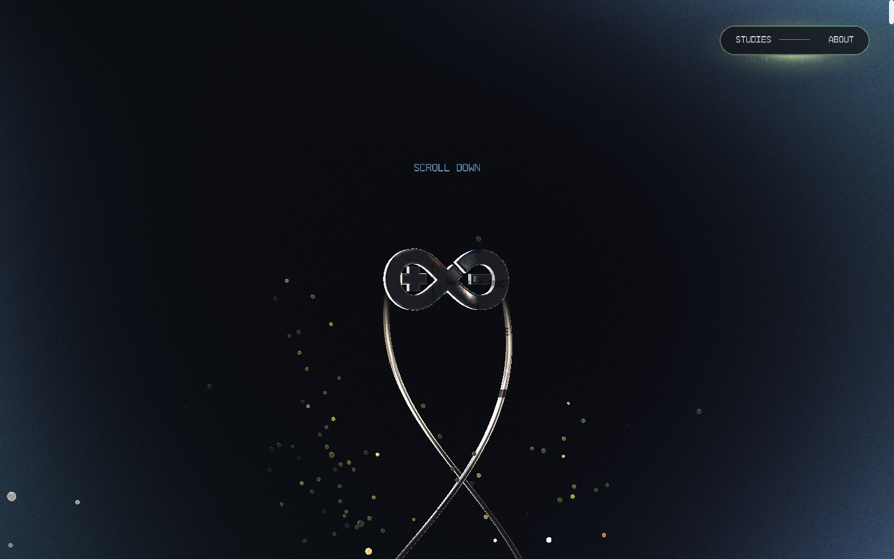
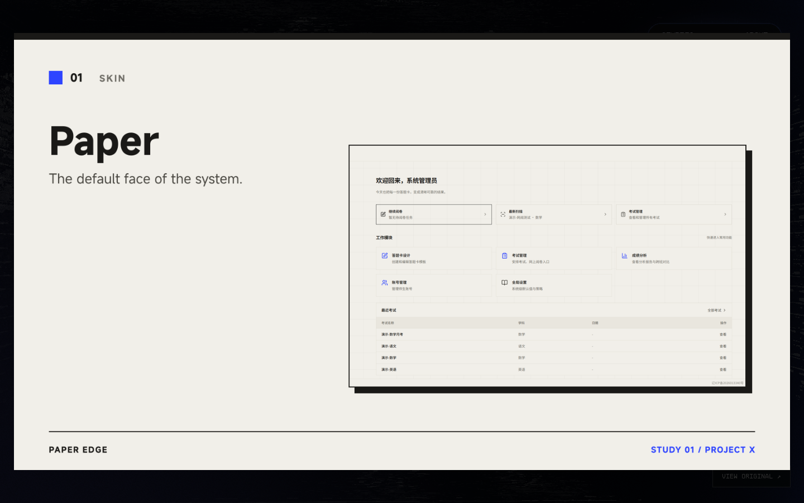
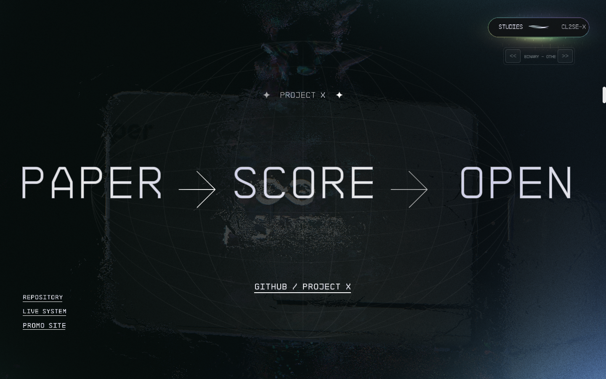

# PROJECT X — From the desk to the record

用莱茵实验室的交互舞台展出试卷星 Project-X：十四段宣传研究、原来的实时三维场景、鼠标粒子，以及深色登录开场。

**[宣传站](https://xiaoxu66609.github.io/Project-X-promo-site/) · [主仓库](https://github.com/Dalian-No-5-Middle-School-I-T-C/Project-X) · [进入系统](https://dl5zx.cn/)**

舞台来自 [open-active-theory](https://github.com/Snychng/open-active-theory) 的发布版，登录开场改编自 [RhineLabUI](https://github.com/LBEILC/RhineLabUI)。这一分支替换展陈内容，并让 iPad 触摸可以滚动、点开研究、看原图再离开。相机路径、场景顺序、粒子、时长和登录字形动画保持原值。磁盘上的 shader 文件不改；展板正面在加载时减轻涂抹，标志玻璃仍用原光学材质。源码公开不代表第三方运行时、字体、音乐或宣传截图获得统一开源授权，详见[来源与许可](#来源与许可)。

## 运行画面

以下画面来自当前网站的实际录制，保留原来的实时 WebGL 渲染。采集与素材说明见 [截图来源](docs/images/README.md)。





## 运行

需要 Node.js 24 或更新版本。

```sh
npm ci
npm run build
npm run dev
```

打开 http://localhost:4199/ 。修改源文件后重新 `npm run build`，刷新浏览器。`PORT=4200 npm run dev` 可指定端口。

## 展示与部署

完整服务需要 Node，用来处理深链接、站内搜索和 WebSocket。静态页发布在宣传站目录下：<https://xiaoxu66609.github.io/Project-X-promo-site/stage/>。构建时使用 `PAGES_BASE=/Project-X-promo-site/stage/`。静态页可以打开首页和由 404 找回的深链接；搜索和房间同步没有后端。

- Ubuntu / Nginx / systemd 示例见 [部署说明](docs/DEPLOYMENT.md) 和 `deploy/`。
- [render.yaml](render.yaml) 是可选的 Render 部署模板；创建服务前自行核对平台当前套餐、配额与区域可达性。
- 本地服务默认监听所有网卡，便于局域网预览。仅本机访问可用 `HOST=127.0.0.1 npm run dev`。

仓库不包含服务器凭据、账户信息、备案资料、证书私钥或录屏成片。

## 已接入内容

- 登录：沿用 RhineLabUI 的标志笔画、身份提示、授权扫描、欢迎页逐帧动画；整体深色，止于欢迎页。主站真实资源就绪且欢迎帧停稳后，约 1.5 秒淡入原三维场景。就绪后可以跳到欢迎页；减少动态效果偏好会直接显示欢迎页。
- 标志：按 RhineLabUI 共享标志的贝塞尔轮廓生成三维挤出模型，替换首页、About、TreeScene、CleanRoom 所需几何和相关贴图。保留原始材质；CleanRoom 中缩小横向标志贴图，避免遮挡两侧文字。展品卡片贴图预留透明边距，避开原 LogoShader 左右各 10% 的裁切区，完整显示标志。
- 十四张展板：1600×900 PNG，构建时按字节复制。有实机截图的用宣传站原图加纸锋硬边；没有截图的只排文字，不画假界面。**无展示视频**。
- 原始特效：相机路径、场景顺序、滚动参数、详情粒子与鼠标流体扰动继续使用原发布版。全屏模式显示完整展板；正常详情仍走原来的实时图形渲染。iPadOS 自报 Macintosh，只要有多点触控就按平板处理，避免触摸被桌面路径吃掉。平板画布和离屏缓冲使用设备像素比，上限 2。
- 文案：考试锁写成 tighter lock，开源署名写成 IT center，About 使用 paper-edge skin。登录页的 RHINE LAB 字形不改。
- 展陈、关于和联系入口是全英文。登录欢迎页里的 RHINE LAB 字形是原开场动画，不改词，否则笔画时间对不上。
- 顺序固定为 Paper → The Desk → Sheets → The Exam → The Scan → Marking → The Record → Two Skins → Calendar → The Week → Reading → On Site → The Roles → Open。

## 编辑入口

- `src/content.mjs`：顺序、英文文字、配色、标签、来源链接。
- `src/assets/promo/`：宣传站实机截图。`scripts/paper-plates.mjs` 用仓库内的 MiSans 排出 `src/assets/rhine/01.png` 至 `14.png`；`sources.json` 记录尺寸与哈希。
- `src/rhine-shape.mjs`：莱茵生命三维轮廓生成。
- `src/boot/upstream/`：RhineLabUI 登录代码及 MIT 许可；`src/boot/entry.js` / `boot.css` / `bridge.html` 为接入与深色适配。
- `scripts/build.mjs`：内容适配、几何生成和原视觉基线校验。`public/` 为生成物与原站依赖资源。

## 验证

先启动服务，再运行 `npm run check`。它核验受保护模块、原始参数、shader、14 张展板尺寸与哈希、深链接、Range 与本地搜索。完整浏览器检查用 `npm test`，记录输出到忽略目录 `.artifacts/`。桌面窄屏模拟不等于真实手机 GPU 验收。

主站音乐默认关闭。About 指向 Project-X 主仓库、正在运行的系统和宣传站。展品链接指向对应的宣传页、系统或仓库。

## 隐私与贡献

提交前检查 `git diff --cached`，不要提交 `.env`、浏览器会话、云账户资料、私钥或部署备份；本地测试输出放在 `.artifacts/`。建议使用 GitHub 提供的 `noreply` 提交邮箱。安装 [Gitleaks](https://github.com/gitleaks/gitleaks) 后可运行 `gitleaks git . --log-opts="--all" --redact` 扫描历史；配置仅排除已核实的动画表达式误报。

发现疑似凭据时，请勿在公开 Issue 中粘贴原值；先通过 GitHub 私密漏洞报告联系维护者。

## 来源与许可

舞台和登录代码的许可没有因为换成宣传内容而改变。RhineLabUI 代码采用 MIT，复制部分保留原许可。开场使用该项目自带固定字形图形和 MiSans。Active Theory 发布包及原站字体、音乐未被授予统一开源许可。三维标志仍是莱茵生命轮廓。细目见 [THIRD_PARTY_NOTICES.md](THIRD_PARTY_NOTICES.md)。
